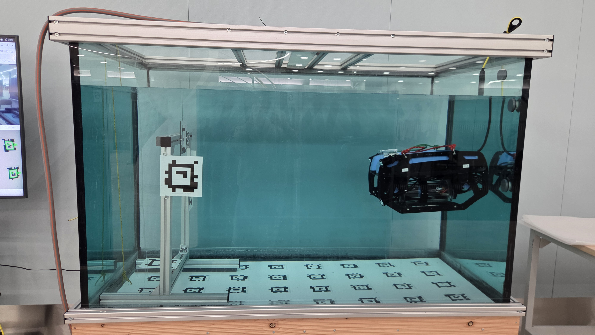
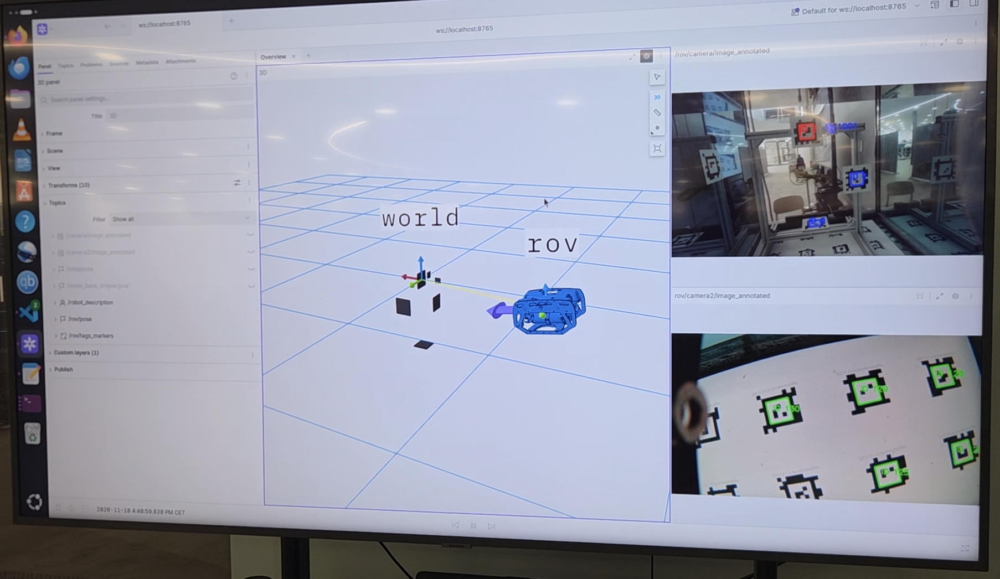

# BlueROV2 Core

ROS 2 Jazzy localization, vision, and telemetry pipeline for BlueROV2.

## Key Features
- **Modular Zero-Copy Architecture**: Decomposed into lightweight, specialized nodes running concurrently via a `MultiThreadedExecutor` and communicating over high-speed thread-safe in-RAM ring buffers:
  - `Camera1Node`: Primary UDP ingestion (port 5600).
  - `Camera2Node`: Secondary auxiliary UDP ingestion (port 5604).
  - `LocalizationNode`: AprilTag visual solver (`tagStandard41h12`) using textbook Dual-Engine PnP (Multi-tag SQPNP + Single-tag IPPE_SQUARE) in ROS FLU coordinates.
  - `AnnotatedPublisherNode`: On-demand visual overlay rendering and lightweight JPEG compression only when subscribers are active (0% idle CPU overhead).
- **Decoupled Launch System**: Run core localization independently in headless mode, launch Foxglove visualization on demand, or start everything together with an all-in-one master launch file.
- **Foxglove Studio Integration**: Zero-latency JPEG-compressed video streaming (960x540 downscaled) with 1MB websocket buffer limits and full 3D URDF model tracking.

---

## 1. Quick Start with Docker

### A. Build the Docker Image
From the repository root:
```bash
cd docker
docker build -t bluerov_core .
```

### B. Launch the Container
```bash
./run.sh
```
*(This mounts your workspace inside the container at `/root/ros2_ws` and forwards network/X11 graphics).*

### C. Build the Workspace
Inside the container terminal:
```bash
cd /root/ros2_ws
colcon build --packages-select bluerov_core --symlink-install
source install/setup.bash
```

To open additional terminals inside the same running container:
```bash
docker exec -it ros2_container bash
source /root/ros2_ws/install/setup.bash
```

---

## 2. Launch Options

You can launch the system according to your operational needs:

### Option A: All-in-One Master Launch (Recommended for full operation)
Starts the entire system (Core Localization + 3D URDF + Foxglove Bridge) in a single command:
```bash
ros2 launch bluerov_core system.launch.py
```

### Option B: Decoupled Operation (Headless & On-Demand UI)

#### Terminal 1: Core Localization (Headless)
Runs only the cameras, AprilTag PnP localization, and pose publishing:
```bash
ros2 launch bluerov_core localization.launch.py
```
*Optional parameters:*
```bash
ros2 launch bluerov_core localization.launch.py cam1_port:=5600 cam2_port:=5604 enable_cam2:=true
```

#### Terminal 2: Visualization & Foxglove Bridge
Publishes the robot URDF model and starts the Foxglove WebSocket bridge (`ws://localhost:8765`):
```bash
ros2 launch bluerov_core visualization.launch.py
```

---

## 3. Recording & Offline Replay (Camera 1)

You can record raw video from the BlueROV2 primary camera and replay it later offline to test localization and Foxglove visualization without connecting to the robot.

### A. Record Video
Captures the GStreamer H.264 UDP stream on port `5600` and saves it to `recordings/video_<timestamp>.mp4`:
```bash
python3 bluerov_core/0take_video.py
```
*(Press `Ctrl+C` or `q` in the preview window to stop recording and save the file).*

### B. Replay Video (Offline Simulation)
Streams a recorded `.mp4` file as an H.264 RTP/UDP stream to `127.0.0.1:5600`, simulating Camera 1:

1. **Terminal 1** (Start the replay — uses the latest video in `recordings/` by default):
   ```bash
   ros2 run bluerov_core replay_camera --loop
   ```
   *(To specify a file: `ros2 run bluerov_core replay_camera --video recordings/video_name.mp4 --loop`)*

2. **Terminal 2** (Launch the full localization & visualization pipeline):
   ```bash
   ros2 launch bluerov_core system.launch.py enable_cam2:=false
   ```

---

## 4. Foxglove Studio Configuration

1. Open **Foxglove Studio** and connect to `ws://localhost:8765` (or `ws://<HOST_IP>:8765`).
2. Add panels:
   - **Image Panel 1**: Subscribe to `/camera/image_annotated` (Primary navigation camera with detected tags).
   - **Image Panel 2**: Subscribe to `/camera2/image_annotated` (Secondary camera feed with tag overlays).
   - **3D Panel**: 
     - Set Fixed Frame: `world`
     - Enable **URDF** (`/robot_description`)
     - Enable **Markers** (`/rov/tags_markers`)
     - Enable **Pose** (`/rov/pose`)
   - **Teleplot / State**: Subscribe to `/rov/pose_human_readable` for live text telemetry.

---

## 5. Topics Summary

| Topic | Type | Description |
|---|---|---|
| `/camera/image_annotated` | `sensor_msgs/CompressedImage` | Primary camera feed with multi-colored AprilTag overlays (on-demand) |
| `/camera2/image_annotated` | `sensor_msgs/CompressedImage` | Secondary inspection feed with green tag outlines (on-demand) |
| `/rov/pose` | `geometry_msgs/PoseStamped` | 6-DoF ROV pose in FLU world coordinates (published only when tags are visible) |
| `/rov/tags_markers` | `visualization_msgs/MarkerArray` | 3D visual cubes of active AprilTags in the world |
| `/rov/pose_human_readable`| `std_msgs/String` | Human-readable XYZ (m) and RPY (degrees) telemetry string |
| `/robot_description` | `std_msgs/String` | BlueROV2 URDF description for 3D visualizers |
| `/tf` / `/tf_static` | `tf2_msgs/TFMessage` | Dynamic ROV transforms and static tag locations |

---

## 6. Experimental Setup & Results

Live water tank experiments demonstrating real-time AprilTag visual localization, tracking, and dual-camera monitoring:

<p align="center">
  
  
</p>
